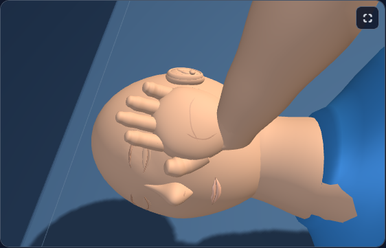
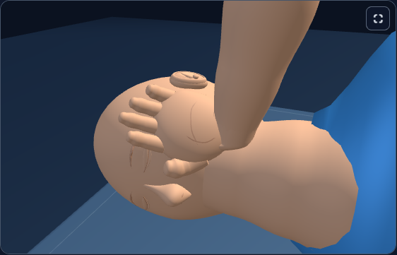
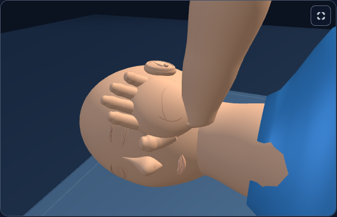
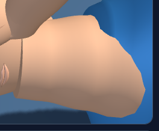
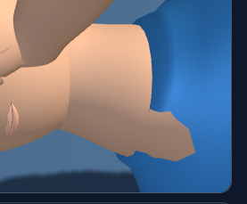
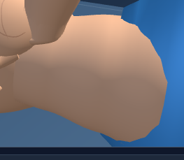
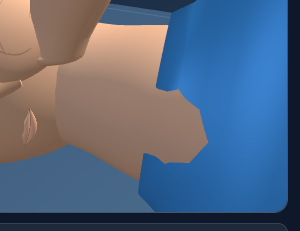
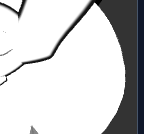
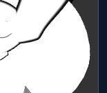

# First Response Lab: head and neck transition

In recovery poses, the neck now meets the head at the head’s accepted resting height. This covers the adult neck’s exposed end cap, which had left a circular edge near the chin. Its other end sits inside the shirt, so the adjusted neck does not expose a cap at the collar.

The head proportions, airway rotation, cheek support, hands, ears and teaching behavior retain their accepted values. The change uses the existing neck mesh and material. Canonical and desktop public runtimes remain identical.

## Matched previews

The pairs use the same cameras and saved state. Adult poses 5 and 8 show the join before and after the airway step; the infant view checks the silhouette at 320px in app contrast.

| View | Before | After |
| --- | --- | --- |
| adult-pose5 |  |  |
| adult-pose8 |  |  |
| infant-pose8-contrast |  |  |

Neck details:

**adult-pose5**

 

**adult-pose8**

 

**infant-pose8-contrast**

 

## Verification

[Geometry verification](checks/accepted-verification.json) passed all 12 recovery cases across adult, child and infant models, with 3,133 assertions and 2,352 sampled cap points inside the actual head and torso surfaces.

[Three matched browser comparisons](accepted-browser.json) passed, using one worker and zero automatic retries. The initial adult pose5 workflow timed out while mounting its candidate; a targeted rerun with a 300-second limit passed in 140 seconds. Its assertions were unchanged. All 14 available captures were inspected, including the 12 accepted paired images.

Two additional CPR comparisons exercised adult maximum depth and infant coach peak. Neither increased cap exposure, and all geometry and transforms outside the neck matched the baseline. Adult extreme compression still has pre-existing collar-cap exposure, so complete cap burial is claimed only for the sampled recovery poses. The existing angular shirt opening is also a future visual refinement.

Cap checks use actual head and torso triangle intersections for cap vertices, perimeter vertices and triangle centroids. They also check the neck’s closed winding, outward normals and side seam. Comparisons against the accepted version verify all geometry and transforms outside the neck, including the head, hands and ears, plus materials, camera metadata, answer targets and resource counts.

The new raw neck test imports the shared geometry assertions. Its input is the actual canonical runtime. The historical ear comparison reverses only this exact neck edit to retain its original scope; existing raw ear tests remain unchanged. The new neck comparison independently proves that current ear geometry is preserved.

One exact source delta reverses to the accepted ear-refined version. Historical fixture helpers compose through that reversal and retain their fixed hashes. No fixture fingerprints or thresholds were relaxed.

Initial diagnostics are retained: the first head-only neck adjustment exposed part of the collar cap, and a private helper extraction boundary was corrected before the final run.

Run the focused portable checker from the repository root: `node dev-tools/firstresponse_neck_refinement_check.cjs`. Its assertion bodies match the executed private checker; only input and output paths differ. The raw Vitest wrapper and shared geometry helper are included in `tests/`. The raw Vitest wrapper also passed one adult pose5 smoke case (11 cases intentionally filtered), using exact copies of the accepted source, test and helper. [Framework evidence](checks/vitest-wrapper-summary.json) includes the retained temporary-cache and initial filter diagnostics.

These are focused geometry and native browser checks. No full application build or full test suite was run for this pass.

Everything remains uncommitted. No staging, push or deployment was performed.
