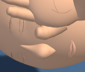
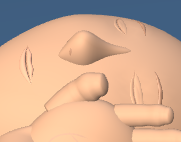
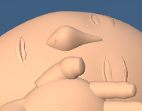
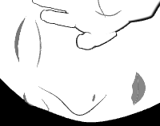

# First Response Lab: nose contour refinement

The fitted nose surface has a fuller bridge and a less prominent tip. The two nostril seams follow the revised surface.

Only the nose and two nostril position and normal buffers change. Geometry counts, rendered triangles, draw calls, materials and shader programs match the baseline. The other mannequin surfaces, head proportions, camera settings, poses, contact, lesson content and controls are preserved.

## Validation

- 12 CPU geometry cases passed across adult, child and infant, two poses and both contrast modes (230,424 checks). The validator checks nose and nostril geometry, surface fit, scene preservation and resource allocation/disposal. Deliberate defects were rejected, and saved bytes were restored and reread.
- 21 unchanged raw nose-surface tests passed. The raw runner also rejected a deliberate private input-hash mutation, then restored and reread the saved source. That runner selftest checks input integrity; the CPU validator checks geometry defects.
- Three raw-module Supporting hand close-up comparisons passed, with one worker and zero retries in each accepted run: 6 captures and 12 PNGs. Adult poses 4 and 5 have changed pixels. The infant high-contrast pose 8 is a control comparison and may match. Cameras, crop framing and scene state match exactly within each accepted pair. Each face crop comes from its full-stage capture.
- Root and independent visual reviews accepted the same 12 image hashes.
- Seventeen exact history reversals passed. All 39 raw test files and 8 existing checkers are preserved. The Git index is guarded against the fresh delivery snapshot. The raw tests were **not run as a whole suite** for this pass.

| View | Changed stage pixels | Browser duration |
| --- | ---: | ---: |
| adult-support | 1363 / 202882 | 41 s |
| adult-support-before | 1429 / 202882 | 38 s |
| infant-support-contrast | 310 / 97976 | 16 s |

## Visual review

- Viewed all twelve final baseline/candidate stage images and face crops after the camera fixture repair.
- The adult supporting-hand views before and after the turn show a less prominent, shallower nasal tip and a gentler bridge-to-tip transition. The change is modest at full-stage scale and clearer in the face crops.
- The rounded tip, tapered bridge and nostril detail remain visible. No new detached edge, sharp ridge or surface gap is apparent in either adult view.
- The infant contrast view retains a readable curved nose outline and nostril marks. This narrow supporting-hand view already crops the outer head edge; it offers limited evidence for surface realism.
- Hand placement, head proportions and surrounding facial landmarks look unchanged in the final comparisons. The mannequin remains stylized.

## Before and after

### adult-support

| Before | After |
| --- | --- |
|  |  |

[Full stage before](evidence/native-adult-support/adult-support-baseline-stage.png) · [Full stage after](evidence/native-adult-support/adult-support-candidate-stage.png)

### adult-support-before

| Before | After |
| --- | --- |
|  |  |

[Full stage before](evidence/native-adult-support-before/adult-support-before-baseline-stage.png) · [Full stage after](evidence/native-adult-support-before/adult-support-before-candidate-stage.png)

### infant-support-contrast

| Before | After |
| --- | --- |
|  |  |

[Full stage before](evidence/native-infant-support-contrast/infant-support-contrast-baseline-stage.png) · [Full stage after](evidence/native-infant-support-contrast/infant-support-contrast-candidate-stage.png)

## Scope and limits

These checks load the raw module through the existing browser harness. The full application loader, full-app build and deployment were not tested. The change remains uncommitted; this delivery performs no staging, commit, push or deployment.

Source: `0af58d9afd30ed0de275caf53197320ddabed9308f08b191cce7bf4927d83f84` → `164407bb58546fc91584761e51e9a907d2eacd33442a0a5fae31da0c22ef37c0`.

## Retained attempts and diagnostics

The first comparison set included an adult Head close-up. Its automatic fitting responded to the changed nasal depth, so baseline and candidate camera coordinates differed and that run was rejected. The superseded passing adult Supporting hand run, rejected Head close-up run and previous fixture are retained in [camera-framing diagnostics](evidence/camera-framing-diagnostics). The accepted comparison set uses Supporting hand close-ups with exact camera equality. The runtime's automatic Head close-up fitting remains unchanged.

No additional unsuccessful native attempts were recorded outside those diagnostics.

CPU and browser evidence, the source delta, compatibility checks and visual reviews are saved under [evidence](evidence). Supporting audit files and directories: cpu-early.json, cpu-summary.json, selftest-invalid-normal.bin, selftest-raised-nostril.bin, selftest-unchanged-profile.bin, camera-framing-diagnostics/.

[Post-write verification](post-write.json) records the installed bytes, syntax, history reversals and preserved inputs.
