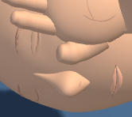
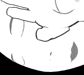

# First Response Lab: nose clarity in contrast mode

Completed October 9, 2026. Changes remain uncommitted.

Added a curved dark contour at the nose edge in contrast mode, helping distinguish the white nose from the white cheek. The contour follows the surface as the view changes. Nose geometry and placement remain identical, and the standard shaded view keeps its existing material.

## Before and after

### Adult, standard view control

| Before | After |
| --- | --- |
|  |  |

[Before full view](native-final/adult-pose5-baseline-stage.png) · [After full view](native-final/adult-pose5-candidate-stage.png)

### Adult, contrast view

| Before | After |
| --- | --- |
|  |  |

[Before full view](native-final/adult-pose5-contrast-baseline-stage.png) · [After full view](native-final/adult-pose5-contrast-candidate-stage.png)

### Infant, contrast view

| Before | After |
| --- | --- |
|  |  |

[Before full view](native-final/infant-pose8-contrast-baseline-stage.png) · [After full view](native-final/infant-pose8-contrast-candidate-stage.png)

## Verification

- **Existing nose tests:** all 21 tests passed against the exact candidate and unchanged test file. [Unit result](raw-nose-surfaces/summary.json)
- **Native Chromium:** three matched workflows passed, producing six source/view captures and twelve stage/detail images. The adult standard view serves as a control; adult and infant contrast views show the change. [Native results](native-final/summary.json)
- **Source and history:** four matching runtime copies, 39 unchanged raw fixtures, eight unchanged existing checkers and twelve exact historical reversals. No new dev-tools checker or unit test was added. [History checks](checks/history-preservation.json)
- **Visual acceptance:** [Visual review](checks/visual-review.json) · [Independent review](checks/independent-visual-review.json).
- **Retained infant failure:** the initial infant run rejected viewer-added opacity metadata in the fixture. The fixture was repaired to preserve that metadata, with twelve negative checks and saved original inputs; candidate source bytes did not change. The separate recovery run passed. [Failed attempt](native-infant-contrast/failure.json) · [Repair record](checks/fixture-opacity-repair.json).
- **Retained adult failure:** the first adult contrast Playwright test passed, but the wrapper exceeded its 900,000 ms total limit, so that attempt was excluded. A separate run passed with the exact same source, fixture, runner, dependencies and time limits. [Wrapper failure](native-adult-contrast/failure.json) · [Playwright result](native-adult-contrast/browser-run.json).

The native harness loads the raw First Response module. This pass does not verify the full application loader or a deployment. Exact source and evidence pins are in [verification.json](verification.json).

Source SHA-256: `af6ecb094af6d67ebb0955170a55e0a9726308c59f4ddd9b196d56cfe434e4c7`.
