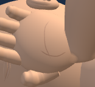
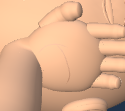
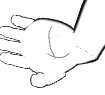

# First Response Lab: mirrored palm surfaces

Palm triangles now follow matching diagonals on both hands. This gives the fitted palm and thumb folds mirrored paths and reduces shading asymmetry in the right patient palm and upper rescuer palm. Small residual normal differences remain near the mesh seam; exact symmetry is verified for the triangle surfaces and crease paths. Palm vertex positions, hand proportions, lesson state, contact and cameras remain unchanged. The existing wrist surface fit follows the corrected palm normals.

## Verification

- All 56 focused raw-module tests passed, including the three hand-symmetry cases that previously failed.
- All 24 geometry cases passed: adult, child and infant; recovery poses 0, 2, 5 and 8; normal and high contrast.
- Three paired native-browser views passed, including narrow-view resize and resource disposal checks.
- Twenty exact historical helper reversals passed. Existing fixtures and checker files are unchanged.
- Deliberate source, geometry, browser-contract and visual-acceptance mutations were rejected and restored.

These checks use raw-module harnesses. The full application loader and full application build were not run. No commit, push or deployment was performed. The original shared Git index was preserved during installation.

## Before and after

### adult-wide

Before

After

### child-narrow

Before

After

### infant-narrow-contrast

Before

After

## Evidence

See [geometry results](geometry-result.json), [raw results](raw-palm-tests/candidate-results.json), [visual review](visual-review.json), [history preservation](history-preservation.json) and [installation checks](post-write.json). The manifest pins the copied evidence. Unsuccessful native attempts, if present, are preserved as diagnostics and excluded from the three successful views.

Baseline: `147670787861ae0251c9b4c65c90847a613c6b879d41737533749c19a5f6f891`

Candidate: `dfe3e01f38a419187e468c749cc37827f486a47401b9916afaa9ec6f98a3f86a`
