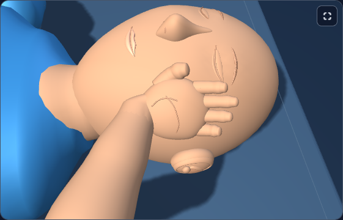

# First Response Lab: clearer mannequin skin

The patient now has a quieter matte finish across the face, ears, neck, arms and hands. Broad pale highlights previously hid cheek curvature, finger pads and wrist slopes. The final shading retains those shapes and makes the skin finish consistent between the face and hands.

## Before and after

These are actual WebGL captures of the same geometry, lights, camera and learner state. The comparison switches only the existing patient's diffuse color and specular color between the previous and final values.

| View | Before | Final |
| --- | --- | --- |
| Adult supporting hand, pose 4 | [Before](adult-dark-pose-4-support-original.png) | [Final](adult-dark-pose-4-support-final.png) |
| Adult palm, pose 5 | [Before](adult-light-pose-5-palm-original.png) | [Final](adult-light-pose-5-palm-final.png) |
| Child supporting hand, pose 8 | [Before](child-light-pose-8-support-original.png) | [Final](child-light-pose-8-support-final.png) |
| Phone infant head, pose 8 | [Before](phone-infant-dark-pose-8-head-original.png) | [Final](phone-infant-dark-pose-8-head-final.png) |

## Implementation

A 354-byte block adjusts the shared normal patient skin after the rescuer material clones have received their own finishes: diffuse color ×0.86 and specular color 0x060606. Shininess stays 12. The face and hands still share their existing material; no scene objects, meshes, buffers, materials or shaders were added.

Both runtime copies are identical, 754,764 bytes, SHA256 **970fbb0e068412f3d3e3fb4ed01013a1afb56b9d5270fb2eb18d24201bfd012c**. Removing the [exact block](finish-block.js) restores the completed supporting-hand baseline byte for byte: **6e24299465bceafcce0f079ef8171d6ab2871f852a64483acad90ac57cd79a9f**. See [source preservation](source-preservation.json).

Geometry, poses, cameras, picking, rescuer finishes, nails, lips, brow/crease materials, clothes, guides, contrast rendering, teaching text and saved learner state remain covered by their previous baselines. The three existing material fixtures assert the new patient values before normalizing precisely those two properties to their old values for comparison. Their fixed geometry/material hashes are retained; no full-scene baselines were recaptured. See [fixture preservation](fixture-preservation.json).

## Validation

- **176 distinct unit checks passed**, in 22 fresh serial processes with one worker. The new 22 checks compare complete before/final scenes across three ages and five poses, plus frames, independent builds and disposal. Existing supporting hand 109, patient contrast 34 and rescuer surface 11 checks also passed. [Summary](unit-final-summary.json), [runner](run-unit.ps1).
- **All three final Chromium workflows passed**, adult/child at 1280px and infant at 320px, with one worker and zero retries. Twelve normal paired conditions and three preserved contrast conditions retain actual draw calls, triangles, geometry/program counts, resource identities, camera, scene transforms, lighting and learner state. [Browser log](browser-final.log), [fixture](../../tests/e2e/firstresponse-patient-finish.spec.ts).
- Phone keyboard controls, 320↔760px camera restoration, contrast rebuild/context loss, forced colors and complete viewer teardown passed. Four scoped axe scans found zero violations. In forced colors, automatic color-contrast calculation is disabled; the other scoped checks run.
- Across the twelve normal pairs, mean luminance in pixels affected by the finish fell **14.6–16.9%**. Measured near-clipped highlights fell by **at least 99.9%** in each pair: 11/12 pairs have zero remaining near-clipped pixels, with 1 remaining pixel across all twelve. The central 80% luminance range retained **76.9–84.7%** of its original variation, preserving surface relief.
- Repeat raster noise was zero. No measured exterior changes or protected interior changes occurred, using an RGB difference threshold of 8, a 2px conservative projected skin mask, and ray-confirmed opaque interiors. Masks use real drawn triangle ranges clipped to all six camera planes. The exterior assertion allows zero changes when repeat noise is zero.

[Complete numerical evidence](validation.json). Captures use native Chromium WebGL with software rendering; these checks do not measure hardware-device frame rate.

## Finish choice and retained diagnostics

The initial ×0.82 finish passed all three workflows, but wider dark head views made fine eyelid and brow curves more subtle. A [native comparison](finish-review/browser-review.log) captured ×0.82, ×0.86 and ×0.88 at the same head camera for all ages, preserving all other render and scene properties. Independent visual review selected ×0.86 for clearer facial marks while retaining matte hand shading. The original [comparison fixture](finish-review/fixture-observed.spec.ts), [phone ×0.82](finish-review/phone-infant-dark-pose-8-head-diffuse-82-gl.png), [×0.86](finish-review/phone-infant-dark-pose-8-head-diffuse-86-gl.png) and [×0.88](finish-review/phone-infant-dark-pose-8-head-diffuse-88-gl.png) are retained. The complete initial finish evidence is in [initial-finish-82](initial-finish-82/patient-finish-metrics.json).

The first adult trial stopped because the centres of large cropped mat triangles fell outside the palm camera. A screen ray grid now covers those visible interiors, using the same opaque 1.5px interior guard and required protected-sample count. Product code and protection thresholds were unchanged for that fixture correction. The [initial failure](initial-adult-trial/browser-adult.log) and its images remain available.

## Per-condition measurements

Means and ranges below use only paired pixels changed by the skin finish, avoiding background or occluder bias. Near-clipped means a maximum RGB channel ≥248 and all RGB channels ≥185. Retained range is the final/previous 90th–10th percentile luminance range.

| Condition | Canvas | Mean retained | Near-clipped pixels | Range retained | Protected samples |
| --- | --- | --- | --- | --- | --- |
| adult-dark-pose-4-support | 559×359 | 85.3% | 35,836 → 0 | 80.2% | 79 |
| adult-dark-pose-8-head | 559×359 | 83.3% | 2,199 → 0 | 81.5% | 67 |
| adult-light-pose-8-support | 559×359 | 83.1% | 6,470 → 0 | 84.2% | 66 |
| adult-light-pose-5-palm | 559×359 | 83.4% | 15,882 → 0 | 77.0% | 24 |
| child-dark-pose-4-support | 559×359 | 85.4% | 36,086 → 0 | 80.5% | 84 |
| child-dark-pose-8-head | 559×359 | 83.3% | 1,494 → 1 | 81.3% | 70 |
| child-light-pose-8-support | 559×359 | 83.3% | 7,895 → 0 | 84.7% | 72 |
| child-light-pose-5-palm | 559×359 | 83.4% | 15,882 → 0 | 77.0% | 24 |
| phone-infant-dark-pose-4-support | 294×329 | 85.4% | 27,720 → 0 | 80.4% | 65 |
| phone-infant-dark-pose-8-head | 294×329 | 83.5% | 427 → 0 | 82.7% | 45 |
| phone-infant-light-pose-8-support | 294×329 | 83.3% | 6,373 → 0 | 82.5% | 64 |
| phone-infant-light-pose-5-palm | 294×329 | 83.6% | 7,448 → 0 | 76.9% | 24 |

Changes remain **unstaged and uncommitted**. No push or deployment.
