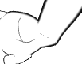
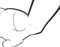
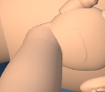
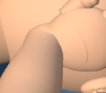
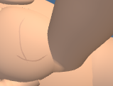
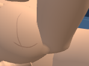

# First Response Lab: patient wrist shading

The patient wrists have smoother shading where they meet the forearms and a more rounded transition into the sculpted palms. Surface normals follow the adjoining surfaces near each join and blend back into the existing wrist shading.

Only the two patient wrist normal buffers change. All vertex positions, silhouettes, geometry counts, materials, cameras, poses, supporting-hand contact, metadata and lesson state are preserved.

## Validation

- 30 CPU geometry cases passed (473,654 assertions). The validator checks the current wrist normals and exact preservation of positions and unrelated scene data. Deliberate defects were rejected, then saved source bytes were restored and reread.
- The two unchanged raw fixtures ran all 56 tests: **53 passed and 3 failed**. All 33 patient-wrist compatibility cases passed; the current hand-surface fixture had 20 passes and three palm-crease mirroring failures. The final candidate results were compared with the preserved, hash-verified baseline run of those three tests. Test names, assertions and numeric values match exactly. That baseline run deliberately skipped the other 20 hand tests; it was reused rather than executed again. No fixture assertion or tolerance was changed. The source-pin and changed-failure selftests rejected deliberate defects, then restored and reread saved bytes.
- Three native Supporting hand close-up comparisons passed: adult wide, child narrow, and infant narrow high contrast. Every accepted run used one worker and zero retries. Cameras, framing, contact, lesson state, draw counts and allocated resources match within each pair. A real child-view resize verifies the camera and resource behavior. Each wrist crop comes from its full-stage capture.
- Root and independent visual reviews accepted the same 12 image hashes.
- A separate adult recovery-pose-8 comparison passed the same scene, camera, contact, normal-buffer and resource checks. Root and independent visual reviews accepted its four image hashes, retained separately below. The diagnostic fixture changes only the adult pose from 5 to 8; the exact derivation and deliberate-rejection checks are saved with it.
- Nineteen exact history reversals passed. All 39 raw fixtures and 8 existing checkers are preserved. The Git index is guarded against the fresh delivery snapshot. The raw tests were **not run as a whole suite**.

| View | Changed stage pixels | Browser duration |
| --- | ---: | ---: |
| infant-narrow-contrast | 68 / 97976 | 83 s |
| child-narrow | 886 / 97976 | 74 s |
| adult-wide | 790 / 202882 | 84 s |

## Visual review

- Reviewed all 12 final before/after stage and wrist images. The adult lower wrist-to-palm join now has a rounded, more continuous shading transition where the baseline had a hard dark lip.
- The adult forearm silhouette remains in the same position. This is a local finish improvement; the revised wrist does not look artificially flat and has no new visible spike.
- The child view has a softer wrist entry while the palm, fingers, supporting-hand contact and framing remain clear and unchanged.
- The infant high-contrast view retains a legible hand outline. Its small wrist-contour change introduces no new dark spike or filled patch.

## Before and after

### infant-narrow-contrast

| Before | After |
| --- | --- |
|  |  |

[Full stage before](evidence/native-infant-fold-final/infant-narrow-contrast-baseline-stage.png) · [Full stage after](evidence/native-infant-fold-final/infant-narrow-contrast-candidate-stage.png)

### child-narrow

| Before | After |
| --- | --- |
|  |  |

[Full stage before](evidence/native-child-fold-final/child-narrow-baseline-stage.png) · [Full stage after](evidence/native-child-fold-final/child-narrow-candidate-stage.png)

### adult-wide

| Before | After |
| --- | --- |
|  |  |

[Full stage before](evidence/native-adult-fold-final/adult-wide-baseline-stage.png) · [Full stage after](evidence/native-adult-fold-final/adult-wide-candidate-stage.png)

### Adult recovery pose 8 — additional diagnostic

| Before | After |
| --- | --- |
|  |  |

[Full stage before](evidence/recovery-fold-native-diagnostic/native-adult-recovery-fold/adult-wide-baseline-stage.png) · [Full stage after](evidence/recovery-fold-native-diagnostic/native-adult-recovery-fold/adult-wide-candidate-stage.png)

- Reviewed all four adult recovery-pose-8 stage and wrist images. The lower wrist-to-palm join has a rounder lighting transition where the baseline showed a hard lip.
- The bent wrist has no new visible dark patch or shading spike. The hand outline, finger placement and contact with the face remain clear.
- The forearm outline and full-stage framing remain aligned in the before-and-after pair.

This is one additional raw-module adult recovery-pose-8 view. The full application loader, build and deployment were not tested.

## Scope and limits

These checks load the raw module through the existing browser harness. The full application loader, full-app build and deployment were not tested. The change remains uncommitted; this delivery performs no staging, commit, push or deployment.

The raw test run remains red because of the three pre-existing palm-crease mirroring failures. Their measured distances are approximately 0.0000114755 against the unchanged 0.00001 tolerance. This shading change leaves those crease positions exact; it does not resolve that separate issue. The gate requires the actual baseline and candidate result files to agree on each failure:

| Test age | Baseline and candidate measured distance | Existing tolerance |
| --- | ---: | ---: |
| adult | 0.000011475498720469535 | 0.00001 |
| child | 0.000011475498720422001 | 0.00001 |
| infant | 0.000011475498720463702 | 0.00001 |

Source: `69d2407c26ddf3e3c5d7ee112622d0dab8613926e34b7d61af9f2e17f1317242` → `147670787861ae0251c9b4c65c90847a613c6b879d41737533749c19a5f6f891`.

## Retained attempts and diagnostics

The shared STEM host changed after the first accepted captures. All four comparisons were rerun against the updated host using unchanged fixtures. Their 16 PNG files exactly match the reviewed images. Previous captures, input manifests and repeat-run logs are preserved under candidate-rejected-host-refresh. The first repeat attempt also discovered an archived fixture; its two browser workflows passed, but the runner rejected the unexpected count. The archive was moved under the existing test exclusion before the successful repeats. These earlier runs are excluded from the final comparison counts.

No unsuccessful native attempts were recorded.

The first candidate adjusted only the forearm join. Its adult comparison showed a small improvement, so it was set aside for a more useful palm-junction refinement. Its source, successful checks and adult images are retained under candidate-rejected-root-only. The accepted adult evidence is stored under native-adult-fold-final; the gate verifies that the superseded native views remain identical to their respective archived copies.

The next candidate improved the palm join in all three native views, but its complete CPU pass found that one already reversed triangle became worse in the adult recovery wrist fold. That candidate and its 253 evidence files are retained under candidate-rejected-recovery-fold. The final refinement preserves the existing shading normals at vertices adjoining a reversed fold face. A fifth deliberate defect removes that protection in recovery pose 8 and must fail. All final native and raw evidence was rerun for the corrected source.

The initial CPU check found inward-facing shading at an existing folded wrist crease in recovery pose 8. The same issue is present in the baseline. The final check prevents newly reversed shading, requires existing reversed faces to retain or improve their normal agreement, and preserves every unchanged face exactly. The failed check and diagnosis are retained under winding-diagnostics and winding-diagnosis.json.

An intermediate check of the rejected root-only candidate ran out of disk space while saving its deliberate-failure evidence. A later rerun completed, and both attempts remain with that candidate's diagnostics. The accepted wrist-and-palm CPU evidence is under geometry-contract-palm-fold. The disk-recovery manifest records older private duplicates removed only after their completed report copies were verified as identical.

The initial filtered baseline test comparison did not complete. A JIT-disabled retry failed before tests because Vite requires WebAssembly. Those unsuccessful attempts and their launch settings are retained under raw-memory-diagnostics. Only the preserved completed baseline run supplies the baseline failure evidence. Two final-candidate raw attempts were interrupted by app refreshes before a result was saved. Their prepared inputs, original runners and available launch/log evidence remain under raw-memory-diagnostics/fold-interrupted-no-result and raw-memory-diagnostics/fold-interrupted-streaming; neither supplies a test outcome. The completed final candidate run is under raw-wrist-fold-tests.

CPU and browser evidence, the source delta, compatibility checks and visual reviews are saved under [evidence](evidence). Supporting audit files and directories: candidate-rejected-host-refresh/, candidate-rejected-recovery-fold/, candidate-rejected-root-only/, cpu-delivery-fold-selftest/, cpu-delivery-selftest/, cpu-palm-summary.json, cpu-summary.json, geometry-contract-final/, geometry-contract-palm/, geometry-contract-palm-fold/, palm-early-check/, palm-early-interior/, palm-prototype-diagnostics/, palm-query-diagnostic/, winding-diagnosis.json, winding-diagnostics/, raw-memory-diagnostics/.

[Post-write verification](post-write.json) records the installed bytes, syntax, history reversals and preserved inputs.
