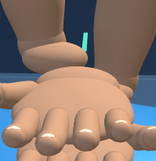
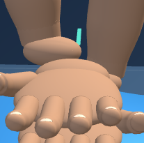
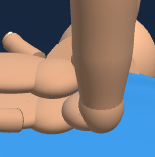
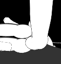

# First Response Lab: rescuer wrist refinement

Completed October 8, 2026. Changes remain uncommitted.

The join between each CPR forearm and hand is smoother. A curved surface replaces the rounded wrist joint, reducing the raised cuff-like ridge. Its ends sit inside the existing forearm and wrist bridge, and it covers the original forearm end cap.

The palm, heel, fingers, arm alignment, hand contact, compression behavior, cameras and lesson content retain their existing geometry and behavior. Only the two wrist joint meshes change. Each uses 1,202 vertices and 2,400 triangles; mesh and material counts remain the same.

The existing wrist bridge retains its rounded pad shape, and a tonal boundary remains at the forearm join. This pass improves the wrist silhouette and reduces banding.

## Before and after

### Adult contact close-up

| Before | After |
| --- | --- |
|  |  |

[Before full view](native-final/adult-oblique-baseline-release-stage.png) · [After full view](native-final/adult-oblique-candidate-release-stage.png)

### Adult heel side view

| Before | After |
| --- | --- |
|  |  |

[Before full view](native-final/adult-heel-side-baseline-compression-stage.png) · [After full view](native-final/adult-heel-side-candidate-compression-stage.png)

### Child heel side view, app contrast, 320px viewport

| Before | After |
| --- | --- |
|  |  |

[Before full view](native-final/child-heel-side-contrast-baseline-release-stage.png) · [After full view](native-final/child-heel-side-contrast-candidate-release-stage.png)

Both released and deepest contact were captured in all three views. [All matched captures and measurements](native-final/wrist-preview-metrics.json) identify the source, camera and contact state for every image.

## Verification

- **Geometry:** 6 age/contrast cases passed, with 43,437 assertions. Checks cover outward faces, normals, closed topology, monotone wrist sections, nonadjacent triangle intersections, buried ends, covered forearm caps and separation from the upper hand. Deliberately exposed boundaries and reversed faces were rejected; restored buffers were reread and checked. [Geometry results](checks/wrist-verification.json)
- **Native Chromium:** three matched workflows passed, with one worker and zero automatic retries. Twelve view/phase/source captures produced 24 stage/detail images. Cameras, contact state, materials, scene transforms and geometry outside the wrists match the baseline. Resource counts remain stable across interaction; teardown disposes the renderer once. [Browser results](native-final/summary.json)
- **Existing hand alignment:** 12/12 unchanged tests passed against the exact candidate. [Results](checks/raw-hand-alignment-summary.json)
- **History and source:** four runtime copies are identical; 39 existing raw fixtures are preserved. Eight exact history reversals retain previous comparison inputs. [History checks](checks/history-preservation.json)
- **Visual review:** root and independent review covered the paired captures. [Review](checks/visual-review.json)

The browser harness mounts the raw First Response module. This pass does not verify the full application loader or a deployment. The first wrist drafts were rejected for folded triangles or incomplete forearm cap coverage. An early browser fixture needed to handle grouped finger meshes; a later run exhausted its 300-second budget during capture. Captures now use one screenshot per phase. The adult side view also hit a screenshot timeout and passed on an isolated rerun. Its successful child companion case was retained; the original mixed run remains recorded as one passed and one failed. Final accepted evidence is pinned in [verification.json](verification.json).

Source SHA-256: `f6cfbcccc65323918d7ca7b209737dcd13cf57a31246da4110f2ab980907147f`.
