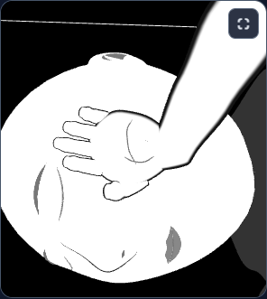
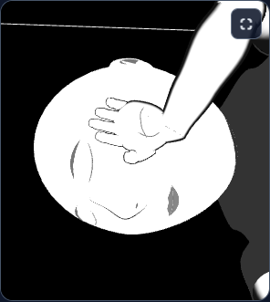
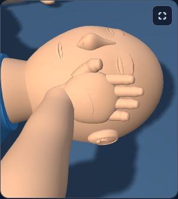
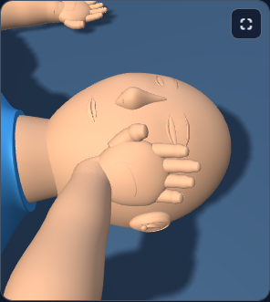
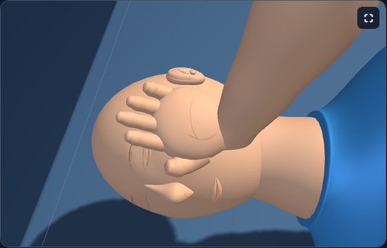

# First Response Lab: supporting hand framing on narrow screens

The Supporting hand close-up includes the posed head on narrow screens. A sphere fitted to the actual head, supporting hand and cheek points keeps the view close while preventing clipping below a viewer aspect ratio of 1.15. The radius is calculated once when the posed scene is built and reused during resize. Wider views retain the existing hand framing.

The geometry, materials, poses, cheek contact, lesson state and resource counts are preserved. Added inspection metadata contains only a numeric center and radius. Camera framing changes only for the narrow Supporting hand view.

## Validation

- 36 CPU cases passed across adult, child and infant, poses 3 through 8, and both contrast modes (4,932 checks). Seven aspect ratios cover the 1.15 threshold; the checker also verifies repeated resize behavior. Deliberate ignored-frame and undersized-frame defects were rejected, then saved source bytes were restored and reread.
- 109 focused raw Supporting hand tests passed. The narrow-view target contract includes the head; prior unrelated assertions remain in place. The runner rejected a deliberate source-pin mismatch, then restored and reread the saved source. Its five copied dependency packages were hash-verified against the originals; the report retains that manifest and omits the copied packages.
- Three raw-module comparisons passed: infant narrow high contrast, child narrow normal, and adult wide normal. Each accepted run used one worker and zero retries. The narrow cameras intentionally change; the wide camera and pixels remain exact. Geometry, materials, pose, contact, state and allocated resources remain equal within each pair. Narrow-view draw calls and rendered triangles may differ because the camera changes which unchanged meshes are visible. A real child-view resize verifies the wide camera match and restores the exact respective narrow view without extra allocations.
- Root and independent visual reviews accepted the same 12 image hashes.
- Eighteen exact history reversals passed. Thirty-eight raw test files and all 8 existing checkers are preserved; one raw Supporting hand fixture is updated for the intended narrow-view framing and full-head visibility. The Git index is guarded against the fresh delivery snapshot. The raw tests were **not run as a whole suite**.

| View | Changed stage pixels | Browser duration |
| --- | ---: | ---: |
| infant-narrow-contrast | 33549 / 97976 | 27 s |
| child-narrow | 66623 / 97976 | 37 s |
| adult-wide | 0 / 202882 | 44 s |

## Visual review

- Root opened all twelve final stage and detail PNGs. The adult desktop pair has identical composition, fingertip contours, face and neck appearance; the native pixel comparison also reports zero changed pixels.
- The child narrow candidate preserves a close view of the palm, thumb and fingers beside the cheek. The entire head has a balanced margin. The rejected box-based candidate showed most of the upper body; this tighter candidate restores useful hand and facial detail.
- The infant high-contrast candidate places the complete left head edge and nose within the image. Finger outlines and cheek contact remain legible, and the head still fills most of the stage width.
- The wider framing changes the view only; paired scene data confirms unchanged anatomy, hand placement, materials and learner state. The child resize comparison returns to the same narrow camera and uses the original camera at wide size.

## Before and after

### infant-narrow-contrast

| Before | After |
| --- | --- |
|  |  |

[Face detail before](evidence/native-infant-narrow-contrast/infant-narrow-contrast-baseline-face.png) · [Face detail after](evidence/native-infant-narrow-contrast/infant-narrow-contrast-candidate-face.png)

### child-narrow

| Before | After |
| --- | --- |
|  |  |

[Face detail before](evidence/native-child-narrow/child-narrow-baseline-face.png) · [Face detail after](evidence/native-child-narrow/child-narrow-candidate-face.png)

### adult-wide

| Before | After |
| --- | --- |
|  |  |

[Face detail before](evidence/native-adult-wide/adult-wide-baseline-face.png) · [Face detail after](evidence/native-adult-wide/adult-wide-candidate-face.png)

## Scope and limits

These checks load the raw module through the existing browser harness. The full application loader, full-app build and deployment were not tested. The change remains uncommitted; this delivery performs no staging, commit, push or deployment.

Source: `164407bb58546fc91584761e51e9a907d2eacd33442a0a5fae31da0c22ef37c0` → `69d2407c26ddf3e3c5d7ee112622d0dab8613926e34b7d61af9f2e17f1317242`.

## Retained attempts and diagnostics

No unsuccessful native attempts were recorded.

An earlier fit based on a world-axis box passed geometry checks but pulled back too far in visual review. It was rejected before application; its source, images and review are retained under candidate-rejected-box-fit. The accepted raw run copied the five required packages, used a 512 MB Node heap limit and completed all 109 tests.

CPU and browser evidence, the source delta, compatibility checks and visual reviews are saved under [evidence](evidence). Supporting audit files and directories: candidate-rejected-box-fit/.

[Post-write verification](post-write.json) records the installed bytes, syntax, history reversals and preserved inputs.
