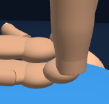
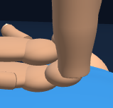
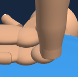
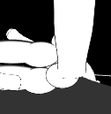
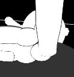

# First Response Lab: wrist shading refinement

Completed October 8, 2026. Changes remain uncommitted.

The forearm-to-wrist lighting transition is smoother. The wrist collar now follows the existing forearm's shading direction, then gradually blends into the wrist's curved surface. This reduces the brightness band at the join.

Only the wrist collar normal buffers change. All surface positions, triangles, materials, transforms, hand placement, cameras and compression behavior remain identical. The adjustment happens when the scene is built. Each wrist keeps its existing 1,202 vertices and 2,400 triangles; mesh, geometry and material counts are unchanged.

## Before and after

### Adult heel side view: release

| Before | After |
| --- | --- |
|  |  |

[Before full view](native-final/adult-heel-side-baseline-release-stage.png) · [After full view](native-final/adult-heel-side-candidate-release-stage.png)

### Adult heel side view: compression

| Before | After |
| --- | --- |
|  |  |

[Before full view](native-final/adult-heel-side-baseline-compression-stage.png) · [After full view](native-final/adult-heel-side-candidate-compression-stage.png)

### Child heel side view, app contrast, 320px viewport: release

| Before | After |
| --- | --- |
|  |  |

[Before full view](native-final/child-heel-side-contrast-baseline-release-stage.png) · [After full view](native-final/child-heel-side-contrast-candidate-release-stage.png)

### Child heel side view, app contrast, 320px viewport: compression

| Before | After |
| --- | --- |
|  |  |

[Before full view](native-final/child-heel-side-contrast-baseline-compression-stage.png) · [After full view](native-final/child-heel-side-contrast-candidate-compression-stage.png)

[All matched captures and measurements](native-final/wrist-preview-metrics.json) identify the source, camera and contact state for every image.

## Verification

- **Shading:** three age cases passed with 15,350 assertions. Across 5 wrists and 240 sampled seam crossings, the maximum normal mismatch fell from 12.97° to 0.22°. Every collar vertex is fitted, normals remain unit length and outward, and the scene matches exactly outside the intended wrist normals. Restoring the original normals fails the seam check; candidate normals are then restored and reread. [Shading results](checks/shading-verification.json)
- **Geometry:** the unchanged geometry gate passed all six age/contrast cases, including its two deliberate failure checks. Surface shape, topology, buried ends, cap coverage and separation from the opposite hand remain valid. [Geometry results](checks/wrist-verification.json)
- **Native Chromium:** two matched workflows passed, with one worker and zero automatic retries. Eight source/view/phase captures produced 16 stage/detail images. Cameras, contact state, materials, transforms, positions and other geometry buffers match the baseline. Resource counts remain stable; teardown disposes the renderer once. [Browser results](native-final/summary.json)
- **History and source:** four runtime copies are identical; 39 existing raw test fixtures and all six existing checkers remain unchanged. Nine exact history reversals retain previous comparison inputs. The raw hand-alignment tests were not rerun in this shading pass. [History checks](checks/history-preservation.json)
- **Visual review:** root and independent review covered the before-and-after captures. [Root review](checks/visual-review.json) · [Independent review](checks/independent-visual-review.json)

The browser harness mounts the raw First Response module. It does not verify the full application loader or a deployment. An initial browser comparison failed because generated Shape identifiers made its geometry fingerprint differ; the fixture repair preserves the actual shape content, and fresh runs provide the accepted captures. The candidate remained unchanged. Slow host startup required a 450-second workflow limit and a 900-second total limit per attempt. The original [failed run](checks/initial-browser-failure/browser-run.json), [fixture repair](checks/native-fingerprint-repair.json), [fingerprint verification](checks/native-fingerprint-verification.json) and [timeout adjustment](checks/native-workflow-timeout-adjustment.json) are retained with the report. Final source and executed-checker pins are recorded in [verification.json](verification.json).

Source SHA-256: `179ddeefd0c930ca4a084d98fc683c321fb4f36f720e62cddf8b30d56b576466`.
