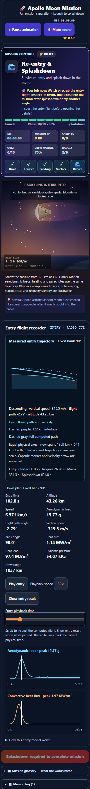

# Moon Mission: entry guidance and measured trajectories

This pass adds selectable capsule lift plans, corrects the aerodynamic load calculation, and makes atmospheric entry inspectable on a measured Earth trajectory. Changes remain **unstaged and uncommitted**, as requested.

## What changed

- The entry planner offers guided lift, a zero-lift ballistic comparison, and a fixed bank from 0° to 180°. Changing lift preserves the verified incoming return interface. Beginning flight freezes the selected plan in the run.
- Bank rotates a lift vector with lift-to-drag ratio 0.3. Its vertical projection changes the flight path; the entire lift magnitude contributes to aerodynamic load. A 90° bank therefore follows the ballistic path in this planar model while producing a different load.
- The recorder shows the actual flight-path angle, vertical speed and bank. Its new Earth diagram uses curved surface/interface coordinates and equal physical axes. The marker, flown path and velocity direction update from the same numerical sample as the heating, load and altitude instruments.
- Chart labels use readable HTML outside their SVG plots. Entry buttons, playback controls and sliders have 44 px targets. The detailed capsule/parachute/recovery scene remains available with the measured trajectory.
- New results carry a versioned plan and compact physical measurements. Saved results are recomputed from their own angle and plan before they can unlock completion. Finite forged measurements, mismatched plans, unsupported terminal clocks and false/string completion flags restart at entry interface. The repaired evidence is also written back to the save.
- Completed flights retain their flown plan through scrubbing, reload, report and archive, even if the next selected plan changes. Authentic version 1 completions retain their original physics. Earlier summaries/history and already-paid reward flags remain available; replay resets the new controls.

## Measured comparison

All five plans begin at −6.5°, 122 km and 11.03 km/s. These are simulator outputs, not historical flight predictions.

| Plan | Peak aerodynamic load | Terminal event | Time |
|---|---:|---|---:|
| Guided lift | 7.20 g | Splashdown | 811.5 s |
| Ballistic | 15.10 g | Splashdown | 624.8 s |
| Fixed bank 0° | 6.51 g | Upward interface crossing | 236.0 s |
| Fixed bank 90° | 15.77 g | Splashdown | 624.8 s |
| Fixed bank 180° | 54.52 g | Splashdown | 533.9 s |

The [raw comparison](physics-comparison.json) includes heat, downrange, receipts and integration-step comparisons. Unit checks cover mechanical energy loss, projected lift versus total load, heating, terminal events and convergence. Fractional playback samples recompute their forces, so a lift cutoff retains an inactive bank instead of interpolating a fictitious angle.

## Model boundaries and sources

The flight uses a spherical, non-rotating Earth, altitude-dependent gravity, a layered atmosphere and fixed capsule mass/aerodynamic properties. The educational controller responds instantly. Lift acts above 3 km/s and switches off below that inherited cutoff; crossrange, winds and attitude dynamics are omitted. The plotted Earth, interface and trajectory share one scale; the craft marker and velocity arrow are enlarged. Convective heating is an energy-transfer estimate. Shield temperature and ablation require a separate thermal/material model. Radio blackout and post-splash recovery are illustrative cues.

NASA's [Apollo Entry Monitor Subsystem report](https://ntrs.nasa.gov/citations/19750005834) describes lift-vector roll attitude and total aerodynamic load, including full positive lift at 0°, the 90° zero in-plane lift attitude and negative lift at 180°. It supports the bank/lift distinction taught here; the simulator's controller is an educational approximation. Existing atmosphere, heating and parachute references remain in the model details.

`entryProfile(angle)` preserves version 1 for compatibility. New plans use `entryProfile(angle, { plan: entryPlan(...) })`. Version 2 receipts use the canonical recorder; active version 1 receipts are checked against the original profile and permit the historical one-decimal peak-load rounding. Earlier version 1 archive shapes remain readable without granting active completion.

## Validation

- **109 unit checks across 11 files pass** on the final runtime: physics, guidance, sampled forces, evidence, geometry, planner, saved state, progression, debrief, return handoff and completion announcements. See [unit-final.json](unit-final.json).
- **13 Chromium workflows pass**, one worker and zero automatic retries. No skipped, unexpected or flaky cases. The final run took 12.1 minutes on the shared host. See [browser-final.json](browser-final.json).
- Both 320 px planner and flight axe scans have zero findings. Keyboard seeking, 44 px controls, readable chart labels and absence of horizontal overflow pass. See [guidance-phone-axe.json](browser/guidance-final/guidance-phone-axe.json).
- Sixteen final captures are inventoried with SHA256 hashes in [verification.json](verification.json). Desktop/320 px trajectory, planner, debrief and skip-out views were visually inspected.
- JavaScript syntax and scoped whitespace checks pass. Canonical/public source bytes match.

### Retained discovery history

The [initial unit report](unit-initial.json) had 102 passes and two fixture failures: a new test attempted to mutate a deliberately frozen selected plan, and an earlier clock test expected an unsupported terminal clock to remain at 2400 s. The corrected assertions explicitly check immutability and restart behavior. The [focused rerun](unit-evidence-final.json) and full final run pass.

The [initial browser report](browser-initial.json) had twelve passes and one failure. A rejected finite result was cleared in the normalized render view but remained in the stored document. Canvas initialization now persists the repaired compact evidence. Review also found that an authentic terminal receipt with a false/string recorded flag could recreate a completion on first paint; the cleaner now restarts that unsupported state. Final browser coverage includes both issues and preservation of the verification message with stale legacy status. Initial failure screenshot, video and trace remain under `browser-artifacts-initial/`.

## Workspace scope

Owned changes are the canonical/public Moon Mission entry regions, three updated compatibility test files, four new focused test files and this report directory. Existing Moonwalk content and unrelated shared edits remain intact. No staging, commit, push, deployment or full application build was performed.

Final source SHA256: `477837f3d482e8b03a074ddd3adfc6a8b60bf60abdbcdbfe937c0e53749062de`.

## Final captures

- [Desktop fixed-bank planner](browser/guidance-final/guidance-planner-bank-90-chromium.png)
- [320 px planner](browser/guidance-final/guidance-planner-phone-320-chromium.png)
- [Measured bank-zero skip-out](browser/guidance-final/guidance-bank-zero-skip-chromium.png)
- [Flown-plan debrief](browser/guidance-final/guidance-flown-plan-debrief-chromium.png)
- [Rejected terminal save](browser/guidance-final/guidance-rejected-terminal-clock-chromium.png)
