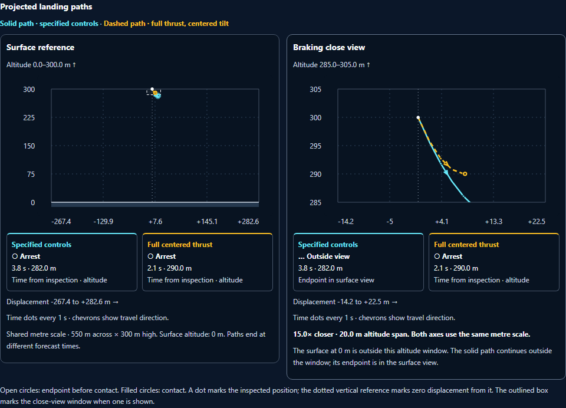

# Moon Mission visual enhancement pass 19

Completed October 3, 2026. Changes remain unstaged and uncommitted.

## Landing charts with physical rulers

The surface and braking close views now have numerical altitude and signed displacement rulers. Five graduations on each axis align with the existing physical grid. Fractional values retain one decimal place; large values use `k` for thousands. Full metre values remain available in each label's title and accessible description.

The rulers use HTML text, so their font stays at 12 px when the SVG scales down. Phones show the first, middle and last displacement labels to keep them apart. Both charts retain equal metre scales on their horizontal and vertical axes. A dotted vertical reference identifies zero displacement from the inspected ground position.

Each chart now has compact summaries for **Specified controls** and **Full centered thrust**:

- Open circles identify arrest, existing arrest, or the forecast time limit; filled circles identify contact.
- Each summary shows the original endpoint's time from inspection and altitude.
- An endpoint outside the close view is labeled **Outside view**, with a reference to the surface view. The chart adds no endpoint at its crop boundary.
- Events within one second show hundredths of a second. Events less than 0.005 s away display **<0.01 s**, keeping them distinct from zero future time at contact.

Arrest still means vertical descent has stopped. Sideways drift can remain. Recorded actual throttle remains a hypothetical future command, as the existing panel explains.

## Compact contact inspection

The terminal chart uses a centered ruler block capped at 360 px wide. It preserves the SVG's aspect ratio and equal physical scales. Both forecasts end at the inspected contact position, with zero further time. Earlier recorder samples restore the full surface and close views immediately.

Path patterns, endpoint shapes, system colors and the dotted reference remain distinguishable in forced colors. The existing 44 px toggle, keyboard control and saved open/closed preference are retained.

## Verification

- **75 unit checks across four files passed** on the final source, including 20 new landmark checks and all 55 prior prediction checks. See [unit-final.json](unit-final.json).
- **All ten Chromium workflows passed** in the full first-candidate run. After the final rounding, imminent-event precision and contact wording refinements, the three affected workflows passed again. Both runs used one worker and zero retries. See [browser-initial.json](browser-initial.json) and [browser-final.json](browser-final.json); [verification.json](verification.json) records their source hashes and scopes.
- **Ten scoped axe scan executions reported zero violations**, including desktop, 320 px phone and forced colors. These are automated checks of the prediction panel.
- **Eight numerical cases preserved their source states and forecast histories.** Ruler coordinate error was below 6e-14 SVG units. See [landmark-geometry.json](landmark-geometry.json).
- Seven final captures and the prior missing-recording capture were inspected visually. See [visual-review.json](visual-review.json).

The first unit run had one new exact-equality assertion fail on the existing floating-point integration horizon. The corrected tolerance and successful subsequent runs are retained. Browser checks cover Chromium; new chart checks use the supported 2D fallback, and the prior active-flight regression retains its WebGL configuration. These results do not measure rendering performance.

## Preserved behavior and scope

The four guarded integration operations reverse exactly to accepted pass 18. Flight and forecast integration, command response, gravity, propellant accounting, contact grading, recordings, scores and rewards retain their existing implementation. The five prior test files are byte-identical. Canonical and desktop public runtime copies match, both syntax checks pass, scoped whitespace checks pass, and the scoped Git index is unchanged. See [preservation.json](preservation.json) and [pass19.diff](pass19.diff).

No staging, commit, push, deployment or full application build was performed.

