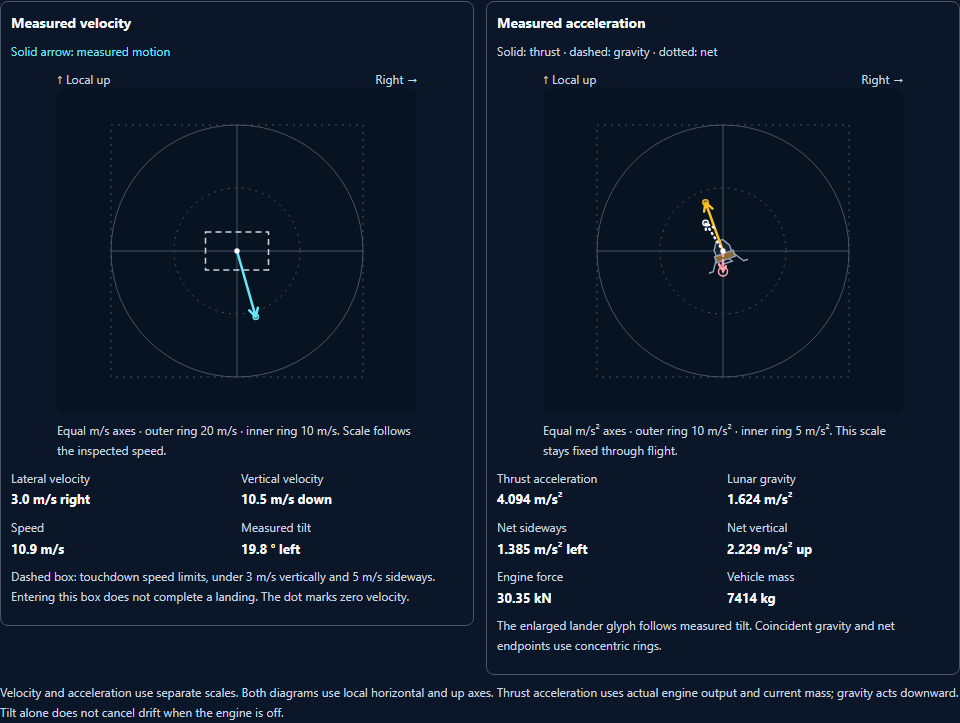

# Moon Mission enhancement pass 20

Completed October 3, 2026. Changes remain unstaged and uncommitted.

## Measured flight vectors

Open **Explore flight vectors** in the descent flight instruments to inspect motion and acceleration. The optional native disclosure starts closed. It adds no saved preference and does not operate the throttle or attitude controls.

Two diagrams explain the distinction between where the lander is moving and how its motion is changing:

- **Measured velocity** shows horizontal and vertical velocity on equal metre-per-second axes. A cyan arrow starts at zero velocity. Its outer ring adapts to the measured speed, and the current scale is written below the chart. A dashed rectangle shows the existing strict touchdown speed limits: below 3 m/s vertically and 5 m/s sideways. Entering the rectangle does not award a landing.
- **Measured acceleration** shows solid amber thrust, dashed pink lunar gravity, and dotted white net acceleration on equal metre-per-second-squared axes. Its outer ring stays at 10 m/s² and its inner ring at 5 m/s². Thrust follows actual engine output divided by current vehicle mass, resolved through measured tilt. Gravity follows the existing altitude-dependent model. Numerical readings include engine force, mass, and both net components.

The enlarged lander glyph turns with measured attitude. During coasting, coincident gravity and net endpoints use concentric rings. Velocity and acceleration have separate labeled scales. Tilting with the engine off retains lateral velocity; balancing gravity with thrust can still leave sideways drift.

Live flight, paused inspection, and recorder review share the same measured presentation. At contact, the diagram retains impact velocity and explains that support and impact forces lie outside the airborne model. Older receipts without a recording explain the missing state and omit both diagrams. Earlier recorded samples restore airborne acceleration immediately.

The diagrams use SVG geometry with HTML labels, keeping text at least 12 px as charts shrink. Cards stack at 320 px. The native summary has a 44 px target, supports keyboard activation, and retains a visible focus outline. Solid, dashed, and dotted patterns remain distinguishable in forced colors. Open active instruments refresh at most four times per second; closing the disclosure skips vector calculations.

## Less duplicate WebGL work during inspection

The descent scene now reuses its last successful render when all visual inputs are unchanged. The frame key includes measured state, simulation time, camera mode, replay mode, canvas dimensions, and compositor readiness. Moving flight, dust settling, camera changes, resizing, replay, and newly ready effects invalidate the frame. Failed draws remain eligible for another attempt.

Browser checks confirm fixed draw counts while paused and renewed draws for camera changes, resize, and powered flight. This is an observed rendering behavior check; no hardware performance benchmark was performed. The existing flight clock, physics, controls, recording, receipts, forecasts, and landing outcomes retain their prior implementation.

## Verification

- **120 unit checks across eight files passed**, including 26 new vector checks. See [unit-accepted.json](unit-accepted.json).
- **Eight Chromium workflows passed** with one worker, zero retries, and unchanged timeouts. They cover existing forecasts and once-only outcomes, actual WebGL flight, paused controls, replay/contact/legacy states, and 320 px keyboard/reduced-motion/forced-color behavior. See [browser-accepted.json](browser-accepted.json).
- **Four scoped axe scans reported zero violations.** Ten native captures were visually reviewed; see [visual-review.json](visual-review.json).
- Eleven numerical probes preserved their source states. Maximum acceleration error against finite differences of the original integrator was **0.0000012581 m/s²**. See [vector-physics.json](vector-physics.json).
- Canonical/public files match. Reversing nine guarded integration edits recovers the exact accepted pass 19 bytes. Ten prior test files and the scoped shared index remain unchanged. Both runtime syntax checks and scoped whitespace checks pass. See [preservation.json](preservation.json).

Earlier failures and captures remain available. They exposed source/camera selector collisions, an incorrect WebGL harness selector, and duplicate paused rendering during capture. One incomplete unit runner omitted the clock file; its seven checks passed separately, followed by the accepted complete rerun. The unsupported unit CLI flag was corrected before test execution. [verification.json](verification.json) records the final source and run history.

