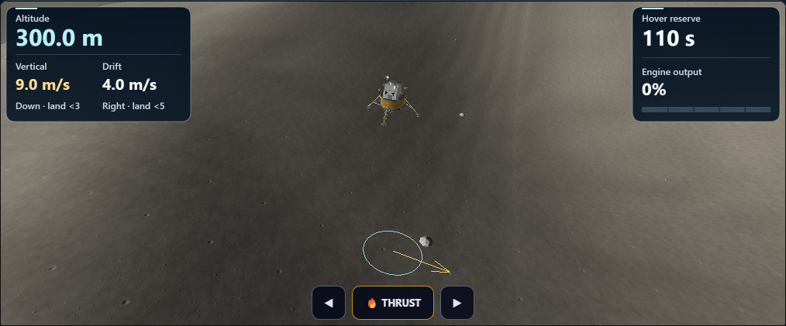
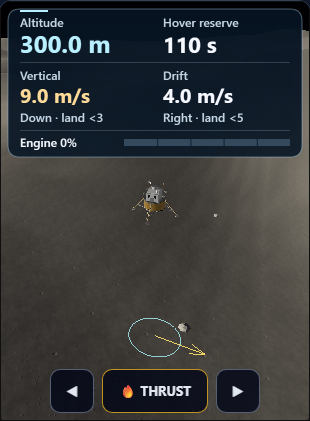
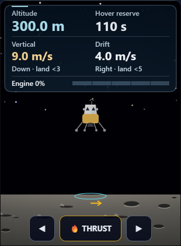

# Moon Mission: clearer descent instruments and phone framing

Completed locally on October 9, 2026. Changes remain uncommitted.

## Changes

- Added larger altitude, vertical speed, drift and hover-reserve readings, with explicit direction and landing limits.
- Added a segmented gauge for actual engine output and consistent reserve warnings.
- Used the same HUD for the 3D view, 2D fallback and saved-flight review. Older saves retain their recorded fuel percentage or show “Not recorded.”
- Fitted the complete 3D craft and surface ring below the phone HUD and above touch controls. Cached hardware bounds keep this work small; all three camera modes retain their viewing direction. Desktop framing restores after resize.
- Reserved room for the banked craft in the compact 2D view and moved the touchdown summary below the HUD.

## Verification

Two Chromium 148.0.7778.96 workflows passed on the final source, using the repository spec’s assertions through the retained [direct Playwright runner](run-workflow.cjs).

- Native: 6 saved stages, 5 screenshots. Desktop, 320-pixel phone, chase/landing/overhead cameras, desktop restoration and actual WebGL context loss. Projected mesh vertices and the surface ring clear the phone HUD and controls. Paused flight, dust and saved results remain identical.
- Fallback: 5 saved stages, 5 screenshots. Official recording scrubber, opposite velocity directions, return to touchdown, legacy percentage fuel and missing fuel. Recorded review omits unrecorded dust.
- Actual painted text bounds stay inside the HUD without overlaps; text is at least 12 CSS pixels. No horizontal overflow, page errors or native shader errors in these workflows.
- Both source copies match; syntax and scoped whitespace checks pass. Six guarded edits reverse exactly to the accepted pass 26 source. All 122 prior Moon-related test files and the scoped Git index are unchanged.

Root inspected all final screenshots. These checks cover the paused presentation and saved recording fixtures used here. Full app builds, broad prior suites, sound and physical-device performance were not tested in this pass.

Final source SHA-256: `db4ac387a5c8b2ac4f4019835837a86005076c3f3d58bd50adaea88c1167a52c`.

## Captures







## Earlier attempts retained

The standard Playwright worker run did not complete successfully: initial attempts had a Windows path-filter issue, a browser-cache lookup failure, then a worker timeout without assertion results. The retained direct runner uses the installed browser and real Playwright assertions from the same spec; it is not reported as a Playwright CLI pass.

The first direct attempt required a TypeScript loader correction. The next exposed a test probe error: the fallback vignette’s final full-canvas fill cleared the recorded HUD text. The probe now observes the actual first HUD label. Browser close needed a longer cleanup allowance; functional assertion limits were unchanged.

Initial HUD workflows passed, but screenshot review found the craft behind the taller phone HUD. Both renderers were corrected and the final native workflow gained independent mesh-projection visibility assertions. Original attempts and captures remain available for comparison.

## Reproduce

From the repository directory, set `PLAYWRIGHT_BROWSERS_PATH` to the installed Playwright browser cache and `MM_DESCENT_HUD_REPORT_DIR` to a fresh output directory. Run one mode at a time:

```text
node reports/moon-mission-enhancement-pass27-2026-10-08/run-workflow.cjs native
node reports/moon-mission-enhancement-pass27-2026-10-08/run-workflow.cjs fallback
```

Use a different output directory for each run. The runner refuses to overwrite earlier results. Detailed hashes, checks and timings are in [verification.json](verification.json); the reversible source edits are in [pass27.diff](pass27.diff).
