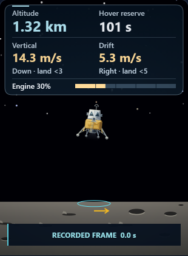
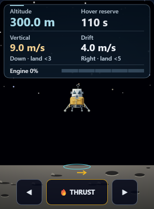

# Moon Mission: detailed fallback lander and clear replay markers

Completed locally on October 9, 2026. Changes remain uncommitted.

## Changes

- Replaced the flat 2D lander with silver cabin facets, gold foil folds, recessed windows, hatch, ladder, shaded engine bell and layered landing gear.
- Kept the existing footpad contact circles, antenna envelope, tilt and exhaust attachment. Artwork is deterministic; flight integration and grading are unchanged.
- Moved the recorded-frame label into the space below the surface markers. The cyan ground ring and amber drift arrow remain visible during replay.
- Hid inactive thrust/tilt buttons after landing. The official Retry → Begin Descent flow restores all three controls.

## Validation

Both focused Chromium 148.0.7778.96 workflows passed on their first attempts, using real Playwright API assertions from the extended HUD spec.

- **3D and context loss:** desktop, 320-pixel phone, all three cameras, return to desktop, and actual WebGL context loss. Paused flight, dust and saved results stay unchanged; live controls remain available.
- **Replay and retry:** both recorded frames, touchdown, older saves with percentage or missing fuel, and the full retry flow. Finished controls are hidden, recorder text fits the bottom band, and retry preserves XP, attempts and reward state.
- **Visual review:** twelve saved stages and eleven screenshots reviewed by the root agent; all six fallback captures also reviewed independently.
- **Preservation:** source/public copies match, syntax and scoped whitespace checks pass, five edits reverse exactly to pass27, and 122 other prior test files are unchanged. The existing HUD regression was extended; its original file and diff are retained. Scoped Git index unchanged.

Full application builds, broad prior suites, audio and physical-device performance were not tested in this pass. The retained runner executes the spec through the Playwright API; these results are not reported as a Playwright CLI worker run.

Source SHA-256: `a4e45616c42a6f15c63e18c66fd33dce9ae00efafe7236d98ee2eff773874f25`.

## Preview





## Reproduce

From the repository directory, set `PLAYWRIGHT_BROWSERS_PATH` to the installed browser cache and `MM_DESCENT_HUD_REPORT_DIR` to a fresh directory for each run. Run sequentially:

```text
node reports/moon-mission-enhancement-pass28-2026-10-09/run-workflow.cjs fallback
node reports/moon-mission-enhancement-pass28-2026-10-09/run-workflow.cjs native
```

See [verification.json](verification.json), [source diff](pass28.diff), and [regression additions](hud-spec.diff) for the exact inputs and evidence.
