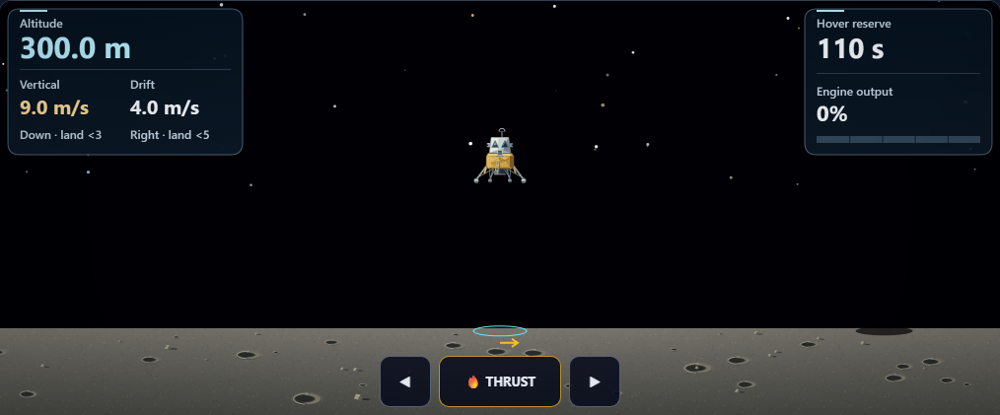
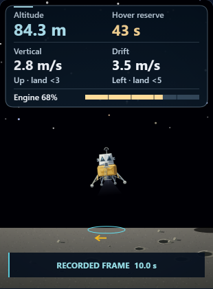

# Moon Mission: continuous shaded 2D lunar surface

Completed locally on October 9, 2026. Changes remain uncommitted.

## Changes

- Added crater bowls with directional inner-wall shading, raised rims and muted ejecta aprons.
- Added faceted rocks with hard shadows whose horizontal reach uses the descent scene's existing Sun direction.
- Replaced the finite scatter with deterministic world tiles, keeping surface details available through long drift in either direction.
- Added subtle regolith grain, cached once per drawing context. Its phase follows the ground during drift and resize.
- Clipped surface artwork below the flat touchdown plane. The lander, landing cues, flight integration and grading retain their existing behavior; the new relief is illustrative.

## Validation

Both final Chromium 148.0.7778.96 workflows passed through the real Playwright API and assertions from the extended HUD spec.

- **Fallback:** replay frames and touchdown, translated saved-recording fixtures at +5 km and -5 km, legacy fuel formats, official Retry → Begin Descent, and resize back to desktop. The translated fixtures test presentation; they are not newly integrated flights.
- **Paused stability:** every canvas RGBA byte remained identical across two animation frames in both distant fixtures and after desktop resize.
- **Native 3D:** desktop, phone, all three cameras, desktop restoration, and actual WebGL context loss into the fallback. Flight state, dust, saved results and controls passed their existing assertions.
- **Visual review:** 15 saved stages and 14 screenshots; all final screenshots reviewed across the root and two review agents.
- **Preservation:** source/public copies match; syntax and scoped whitespace checks pass. The two source edits reverse exactly to the accepted pass28 baseline. All 122 other prior tests and the scoped Git index remain unchanged. The extended HUD spec's original version and diff are retained.

The preliminary fallback run also passed and is retained in `direct-fallback-1`. Final acceptance uses `direct-fallback-2` and `direct-native-1`, both on the source hash below. These are direct Playwright API results, not a Playwright CLI worker run. Full application builds, broad prior suites, audio and physical-device performance were not tested in this pass.

Source SHA-256: `4ef39e3b490912b385c0e921096368b25f403bca83cd2498cc194aabdc0dc3f1`.

## Preview





## Reproduce

From the repository directory, set `PLAYWRIGHT_BROWSERS_PATH` to the installed browser cache and `MM_DESCENT_HUD_REPORT_DIR` to a fresh directory for each run. Run sequentially:

```text
node reports/moon-mission-enhancement-pass29-2026-10-09/run-workflow.cjs fallback
node reports/moon-mission-enhancement-pass29-2026-10-09/run-workflow.cjs native
```

See [verification.json](verification.json), [source diff](pass29.diff), [regression additions](hud-spec.diff) and [preservation checks](preservation.json) for exact evidence.
