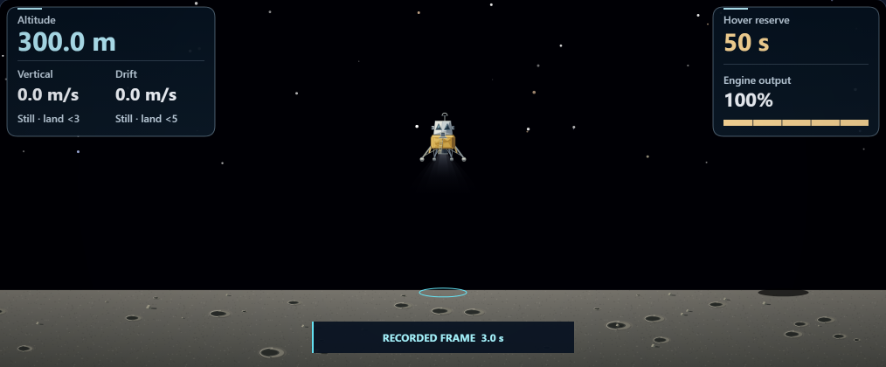
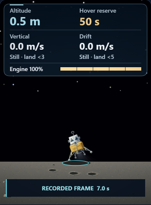

# Moon Mission: attached, surface-clipped descent exhaust

Completed locally on October 9, 2026. Changes remain uncommitted.

## Changes

- Both plume layers previously began at different heights; the bright inner layer began inside the bell. Every new fan starts at the existing nozzle exit, with its aperture fitted inside the rim.
- Four subtle translucent fans give the exhaust a soft expanding edge. Length and opacity follow measured engine output.
- The plume draws behind the lander, preserving the bell, braces and pads. A clip established in the world frame prevents either side of a banked fan from painting below the visible ground.
- The rendering is deterministic while paused. Existing thrust threshold, empty-fuel and completed-flight gates remain intact.

This is illustrative 2D artwork. Flight integration, grading, the ballistic dust model and the native 3D plume are unchanged. A physical gas-flow model is beyond this change; [NASA's plume-surface interaction overview](https://www.nasa.gov/directorates/stmd/plume-surface-interaction-psi/) describes that separate modeling problem.

## Validation

Three final Chromium 148.0.7778.96 workflows passed through the real Playwright API, with 25 saved stages and 24 reviewed screenshots.

- **New plume checks:** actual canvas on/off pixel comparisons at low/full output, 0.5 m clearance with level and ±0.35 radian bank, empty fuel, throttle threshold and touchdown; phone and desktop. The fixtures use the official recording scrubber and do not claim newly integrated flights.
- **Measured safeguards:** zero changed ground pixels below the surface and zero changed pixels upstream of the nozzle region; visible nozzle connection in firing cases; a larger, brighter footprint at full output; no exhaust in cutoff cases; exact paused RGBA stability.
- **Existing fallback workflow:** recorded frames, touchdown, distant positive/negative ground positions, legacy fuel displays, official retry and desktop resize.
- **Existing native workflow:** all three cameras, phone/desktop, actual WebGL context loss and fallback; existing state, controls, dust and receipt assertions passed.
- **Preservation:** both runtime copies match and parse; scoped whitespace/index checks pass. The two source edits reverse exactly to pass29. All 123 prior test files remain unchanged; one focused browser regression was added.

The initial fallback attempt was interrupted with partial evidence retained. A plume runner startup exit and a final-index fixture failure are also retained. The fixture was corrected by adding a terminal saved-outcome row; no runtime change was needed. Final acceptance uses `direct-plume-3`, `direct-fallback-2` and `direct-native-1`.

These are direct Playwright API results, not a Playwright CLI worker run. Full builds, broad prior suites, audio and physical-device performance were not tested.

Source SHA-256: `98327517728da200d877cb7a1332e59519a7701ad5133bbb496a6824be23e324`.

## Preview





## Reproduce

From the repository directory, set `PLAYWRIGHT_BROWSERS_PATH` to the installed Chromium cache and `MM_DESCENT_HUD_REPORT_DIR` to a fresh directory per run. The retained driver sets the plume report directory too. Run sequentially:

```text
node --max-old-space-size=512 reports/moon-mission-enhancement-pass30-2026-10-09/run-workflow.cjs plume
node --max-old-space-size=512 reports/moon-mission-enhancement-pass30-2026-10-09/run-workflow.cjs fallback
node --max-old-space-size=512 reports/moon-mission-enhancement-pass30-2026-10-09/run-workflow.cjs native
```

See [verification.json](verification.json), [source diff](pass30.diff) and [preservation checks](preservation.json).
