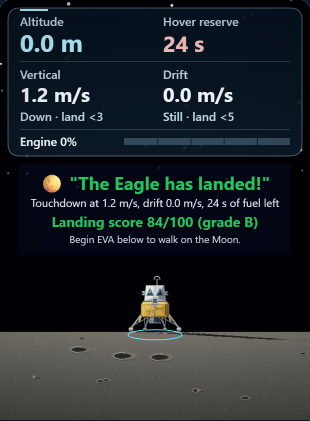
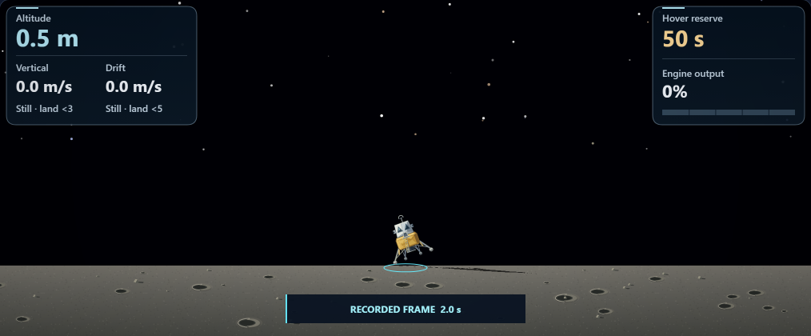

# Moon Mission: projected 2D lander shadow

Completed locally on October 9, 2026. Changes remain uncommitted.

## Changes

- Replaced the fixed oval with the existing lander's silhouette, including the cabin, foil body, engine, braces, antenna and pads.
- Projected every point using the scene's parallel Sun direction and the lander's current bank and height. The contacting pad stays anchored; the raised cabin still casts an extended shadow at touchdown.
- Cached a 256 × 256 black mask per drawing context and applied one shared opacity. Replays and resizing reuse the same mask.
- Clipped the shadow to the ground and kept the landing ring, drift arrow, plume, lander and dust in front of it.
- Clarified the model note: this is a flat silhouette projected onto level ground, with ground depth compressed for the side view.

Flight integration, grading, saved state, dust physics and native 3D shadows are unchanged.

## Validation

Four final Chromium 148.0.7778.96 workflows passed through real Playwright API assertions. They saved 33 states and 32 screenshots, all visually reviewed across the root and review agents.

- **New shadow workflow:** seven phone poses plus desktop resize cover 300 m, 0.5 m and touchdown, with level and ±0.35 radian bank. These are saved presentation fixtures selected through the official scrubber.
- **Geometry:** the actual canvas transform matches independent Sun-ray/plane intersections. Maximum measured error was 0.00001526 CSS pixel, below the 0.001-pixel renderer tolerance. Lowest contact-pad projections remain at their ground coordinates.
- **Pixels and cache:** the shadow only darkens the ground; no fully sky pixel changes. The black mask contains transparent gaps and uncut edges. Its identity and checksum stay unchanged through all poses and resize; paused canvas RGBA bytes remain identical.
- **Existing regressions:** recorded HUD, distant terrain positions, legacy fuel and retry; plume output/attachment/ground clipping/cutoff; all native cameras, desktop/phone and actual WebGL context loss.
- **Preservation:** runtime copies match and parse; scoped whitespace and index checks pass. Three guarded edits reverse exactly to pass30. All 124 prior test files remain unchanged; one browser regression was added.

The first shadow run exposed an overly strict 1e-8-pixel test tolerance for the browser's transform representation. Its observed difference was about 0.00001445 pixel. The test now allows less than 0.001 pixel and saves raw measurements before assertions. No runtime change was made; the failed result and original spec are retained.

These are direct Playwright API results, not CLI worker runs. Full builds, broad prior suites, audio and physical-device performance were not tested.

Source SHA-256: `3eb7f16aaf552228af9c6e6eceda61ce871516c8a7ed4611b983965c41e85a8a`.

## Preview





## Reproduce

From the repository directory, set `PLAYWRIGHT_BROWSERS_PATH` to the installed Chromium cache and `MM_DESCENT_HUD_REPORT_DIR` to a fresh directory for each run. The retained driver sets the mode-specific report variables. Run sequentially:

```text
node --max-old-space-size=512 reports/moon-mission-enhancement-pass31-2026-10-09/run-workflow.cjs shadow
node --max-old-space-size=512 reports/moon-mission-enhancement-pass31-2026-10-09/run-workflow.cjs fallback
node --max-old-space-size=512 reports/moon-mission-enhancement-pass31-2026-10-09/run-workflow.cjs plume
node --max-old-space-size=512 reports/moon-mission-enhancement-pass31-2026-10-09/run-workflow.cjs native
```

See [verification.json](verification.json), [source diff](pass31.diff) and [preservation checks](preservation.json).
