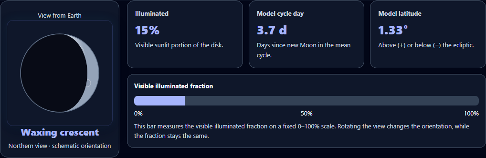
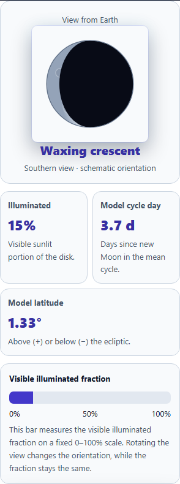

# Moon observer enhancement — 2026-10-05

The Moon lab now presents a large phase portrait beside its measurements before the orbital diagram. On narrow screens, the portrait and readings stack in the normal page flow so learners can inspect the phase without first scrolling across the scientific model.

Full workbench screenshots: [before on phone](before-moon-320-light-45-30-phone.png), [after on phone](after-moon-320-light-45-30-southern.png), and [full Moon on desktop](after-moon-1060-dark-180-0-full.png).

## Changes

- Added a masked SVG phase portrait with a shaded surface, crater details, a clear outline, and a named northern or southern viewing orientation.
- Moved illuminated fraction, mean-cycle age, and signed model latitude into prominent measurement cards. Added a fixed 0–100% illumination meter so different phases remain directly comparable.
- Improved text contrast, phone spacing, control targets, keyboard focus, and the locally scrollable orbital diagram. The portrait stays inside the viewport in both themes.
- Preserved fractional geometry when restoring a session and recording evidence. Finite numeric values and nonblank numeric strings are bounded without rewriting restored data during rendering.
- Restricted restored predictions to complete, correctly typed records that match the actual geometry and one of the three available choices. Classification remains hidden until a valid prediction is made.
- Added synchronous guards for repeated prediction and evidence actions. Updates to both geometry axes merge against the latest state. Changing geometry starts a new prediction; flipping the view preserves the trial and evidence.
- Validated Moon progress markers while retaining historical journal evidence and literal saved markers. Exploration and evidence saving remain ungraded.

## Scientific scope

The existing teaching model is retained: illuminated fraction is `(1 − cos phase) / 2`, lunar age uses a mean 29.53059-day synodic cycle, and the model orbital inclination is 5.145°. Northern and southern views rotate the visible phase without changing its illuminated fraction. The portrait depicts ordinary phase illumination; lunar eclipse shading is represented by the separate alignment model.

The classification uses the existing illustrative phase and latitude windows. It is a geometry exercise, not a prediction of actual eclipse dates or visibility.

Primary references: [NASA Moon phases](https://science.nasa.gov/moon/moon-phases/), [NASA eclipse geometry](https://science.nasa.gov/eclipses/geometry/), and [NASA lunar orbit and inclination](https://eclipse.gsfc.nasa.gov/SEhelp/moonorbit.html).

The references were reviewed on 2026-10-05. A separate source review confirmed the phase masks, hemisphere rotation, mean-cycle values, and preserved learning gate; its trial-reset finding was fixed before final verification.

## Verification

All checks are complete. The validated results and case names are recorded in [verification-summary.json](verification-summary.json).

| Check | Result |
| --- | --- |
| Unit checks | 65 passed across six files: 22 new observer cases and 43 existing science, theme, and learning checks |
| Chromium browser scenarios | 16 passed: 10 new observer cases and six existing Moon lab and phase navigator scenarios |
| Visual states | 16 passed at 320, 736, and 1060 pixels |
| Minimum measured enabled text contrast | 7.058:1 |
| Minimum measured HTML text size | 13px |
| Minimum measured native control height | 44px |
| Page overflow and runtime errors | None in the verified states and browser scenarios |
| Syntax, scoped whitespace, and Git diff whitespace | Passed |
| Canonical and desktop copies | Byte identical |

The visual matrix includes both themes, northern and southern views, all phase families, fractional geometry, malformed restores, committed predictions, and saved evidence. Browser coverage also checks local SVG scrolling, native keyboard focus and activation, same-frame interactions, returning to a previously saved trial, and preservation of other learning state.

The first unit run passed 61 checks but encountered a worker startup timeout before the four science trust checks could begin. Those four passed in a separate run. An initial browser run exposed an incomplete quiz fixture; the corrected fixture passed the full 16-scenario run. The native SVG geometry check uses a 0.001px tolerance alongside a strict raw-attribute oracle.

Verified source SHA-256: `2fa42601621962deae9ea800a14ac27ee3978d02ae1f6a979a2a46f6f633f521`.

The canonical tool and desktop copy are kept identical. No commits have been created by this task.
