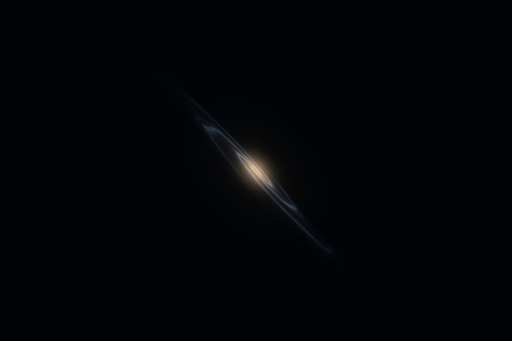
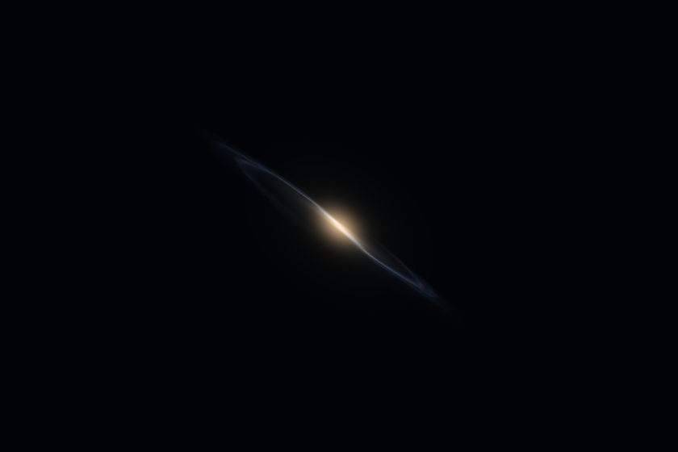
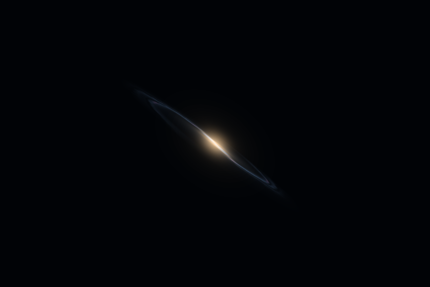

# Sharper galaxy views at shallow angles

Enhancement 54 improves the sampling of Universe's existing galaxy texture as the camera moves around a disk. Auto and High use at most four times anisotropic filtering, bounded by the browser's capability. Low retains the original sampler. The implementation follows the texture handling already used in Galaxy and Solar System and the [Khronos WebGL specification](https://registry.khronos.org/webgl/extensions/EXT_texture_filter_anisotropic/).

The optional capability is queried once per renderer. Quality changes update the sampler only when its value changes, explicitly binding the galaxy texture. Unsupported capability and optional query or setting failures retain normal rendering. Cloud sampling stays at its original value. No extra GPU textures, buffers or programs are allocated.

## Matched native renders

`native-check.json` records 52 captures across the previous renderer, the installed refinement, unsupported capability, a lower hardware cap, and optional query and setting failures. Views cover spiral, two-arm, barred and elliptical galaxies, grazing angles, the near-disk fade, distant groups, relativity, stars, clouds and Low quality.

The six oblique and shallow spiral portraits show more arm contrast. Their average image brightness changes by less than 0.06%. The screen-space contrast measurement describes these matched renders; it is not a physical resolution or photometry measurement. Both atlas byte hashes, all three star-population hashes and all twelve authored flyby camera snapshots remain identical. Stars, clouds, Low quality and unsupported or failed capability preserve the previous pixels exactly. All scenes release their two textures, two buffers and two programs, with no WebGL or page errors.

| Prior sampling | Refined sampling |
| --- | --- |
|  |  |
|  |  |

The filter improves an illustrative atlas. The model's emission, object positions, camera paths, geometry and optical calculations remain unchanged. This pass adds no astronomical data or volumetric light transport.

## Unit coverage

The broad run selects all 31 Universe test files. All 348 existing cases pass. One new test initially assumed resource deletion order; it was corrected to check resource identity and exact-once cleanup. The focused rerun passes all 16 new cases, for 364 unique passing tests across both runs. Raw results are retained in `unit-tests.json` and `texture-tests.json`.

The new cases cover standard and prefixed capabilities, hardware caps, unsupported or malformed values, acquisition/query/setting failures, texture binding, cached quality changes, saved-view restore, running camera glides, unchanged uploads and shaders, context loss, disposal and unavailable WebGL.

## System colors

The browser audit initially mixed authored pale text colors with forced white backgrounds. The diagnostic screenshot and computed styles showed readable black text on white system surfaces. The fullscreen panel now explicitly pairs Canvas and CanvasText, with Highlight for selected controls, focus and range accents. This makes the palette consistent in rendering and automated checks. The added rules apply only in forced-colors mode; UI logic and ordinary display styles retain their exact source after removing that media block. The earlier audit and computed-color evidence remain in `controls/browser-check-before-colors.json` and `controls/diagnostic/`.

## Controls and previews

`controls/browser-check.json` passes six workflow groups and nine scoped accessibility audits, with nineteen sampler records and four screenshots. Main and fullscreen quality controls share their value; Low uses one, and High/Balanced use the supported cap of four on the tested browser. Clouds retain one. Extension and maximum queries each occur once. Switching quality during a viewpoint glide preserves camera pose, progress, clocks, lens, framing and exact arrival. Pause freezes the rendered pixels. Phone, short landscape, reduced motion, and all three fullscreen tabs in system colors pass. The served source hashes match the installed files.

The twelve rebuilt preview cards retain all twelve authored poses. Six galaxy images reflect the new sampler; six stellar and nebula images remain byte-identical. The source and desktop images and manifests match. `previews/contact-sheet.png` shows the refreshed set.

## Reproduce

Run from the repository root with the existing Playwright browser installation:

```powershell
$env:PLAYWRIGHT_BROWSERS_PATH='C:/Users/cabba/AppData/Local/ms-playwright'
node dev-tools/universe_flight_angle_detail_check.cjs
node dev-tools/universe_flight_angle_controls_check.cjs
$env:UNIVERSE_PREVIEW_REPORT='reports/universe-flight-2026-09-29/angle-detail/previews'
node dev-tools/build_universe_flight_previews.cjs --build
node dev-tools/build_universe_flight_previews.cjs --check
```

The controls check uses `dev-tools/universe_flight_preview.cjs` on port 3187. `baseline-renderer.js` preserves the prior source for repeatable image comparisons. `verification.json` pins the final source, UI, tests, harnesses and evidence. Changes remain uncommitted.
