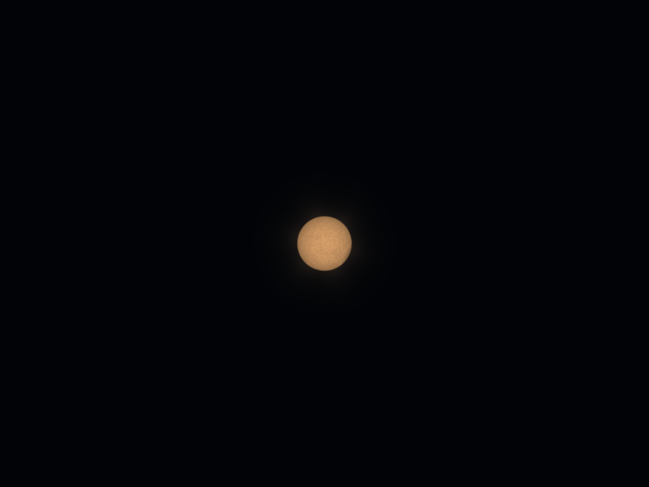
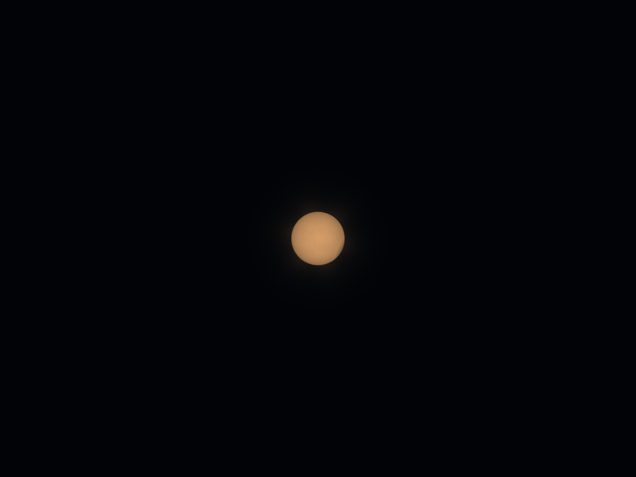
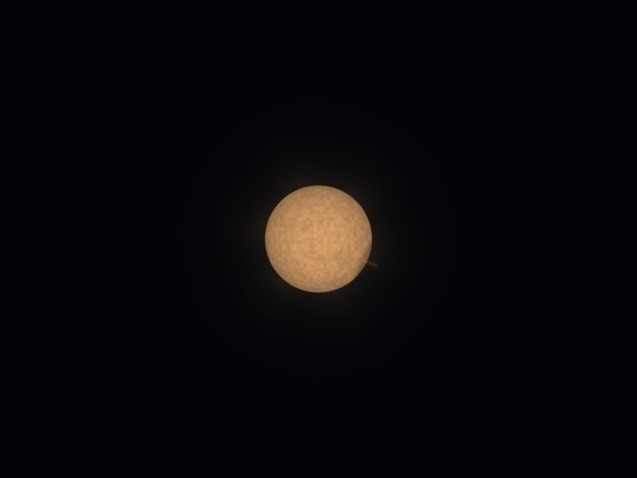
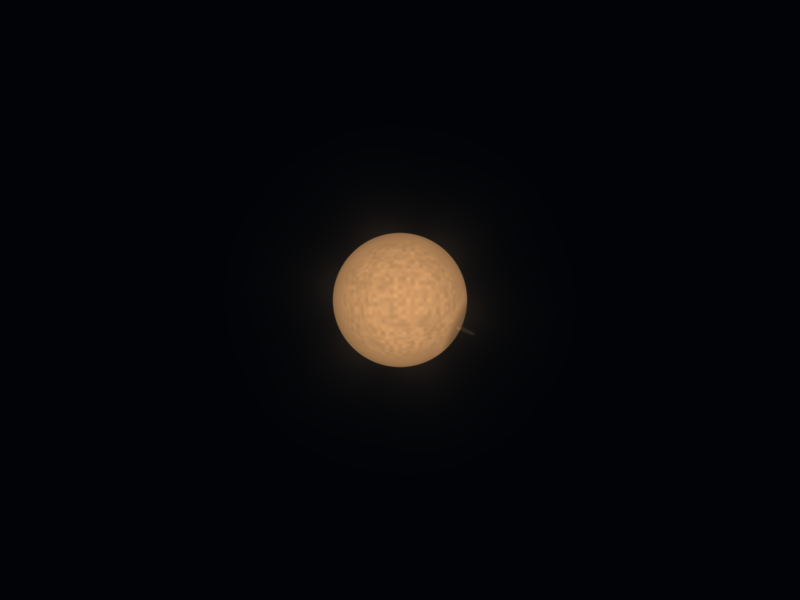

# Resolution-aware stellar detail

Enhancement 55 filters the existing fine granules on the three enlarged nearby star surfaces. Detail fades in as the local surface gains enough physical screen pixels. The photosphere keeps its broad pattern, dark regions, limb shading and outer glow.

The source-sphere map stretches toward the rim. Its least resolved direction has an effective pixel budget of the projected disk diameter multiplied by the existing sphere cosine, `mu`. The fine field fades between 48 and 96 effective pixels; it is skipped below that window. Fully resolved core pixels retain the original field. The thresholds are conservative display choices, not a calibrated physical granule scale.

The existing 132–240 CSS-pixel structure fade and point-to-quad handoff remain in use. Low, Auto and High feed their actual rendering resolution into the new local fade. The rule uses the existing sphere reconstruction and needs no new WebGL capability, uniform, varying, texture, buffer or program.

The stellar material remains a fixed illustrative appearance. It does not simulate convection or evolving plasma. The change filters that material; the authored star positions, source sizes, camera paths and optical calculations retain their values.

## Evidence

`projection-audit.json` checks the surface projection independently with finite differences. `native-check.json` compares the prior renderer with the refinement and a clearly labeled zero-fine-granule diagnostic. `unit-tests.json` records the existing Universe regression suite. `verification.json` pins the final files, reports and preview manifest.

All 364 regression cases pass across 31 test files. The native proof covers 93 observations, including 81 saved PNGs, 29 surface comparisons, three 30-size flux sweeps and nine graphics lifecycles. Representative Low, Auto and High settings, two pixel densities, a forced 16px point cap, source hemispheres and both relativity displays are covered. Pause retains exact pixels and snapshots. Resolved cores and outer glow stay exact; the three point populations, both atlases and all twelve scenic camera poses retain their values.

At the tested medium size, fine residual RMS falls to 16.5–17.4% of baseline. This measures how much unresolved fine texture is removed; it is not a direct temporal-flicker measurement. Background-subtracted, area-normalized display flux differs by less than 0.074%. The independent sphere-projection check covers eighteen locations with a maximum relative error below 7.4e-10. See `native-evidence.md` for the masks, raw measurements and preserved initial clipping-guard failure.

The preserved `baseline-renderer.js` and `baseline-manifest.json` support repeatable comparisons. `previews/contact-sheet.png` shows the refreshed twelve scenic cards. Changes remain uncommitted.

## Reproduce

From the repository root, use the installed renderer and preserved baseline:

```powershell
$env:PLAYWRIGHT_BROWSERS_PATH='C:/Users/cabba/AppData/Local/ms-playwright'
node dev-tools/universe_flight_stellar_sampling_check.cjs --recheck
$env:UNIVERSE_PREVIEW_REPORT='reports/universe-flight-2026-09-29/stellar-sampling/previews'
node dev-tools/build_universe_flight_previews.cjs --build
node dev-tools/build_universe_flight_previews.cjs --check
```

Omit `--recheck` for fresh native captures. The recheck verifies stored PNG bytes, decoded pixels and recorded measurements. It retains the initial failed-guard report for review. The regression report lists all 31 test file paths and their 364 assertions.

## Matching star views

| View | Before | Refined |
| --- | --- | --- |
| Amber, medium disk |  |  |
| Amber, larger disk |  |  |
